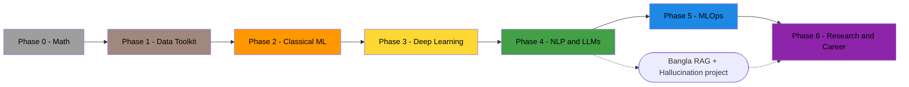

# 🧠 AI/ML Roadmap - Home

Back to [[Command Center]]

Math → Data Toolkit → Classical ML → Deep Learning → **NLP & LLMs** → MLOps → Research
**Phases:** [[Phase 0 - Math|0]] · [[Phase 1 - Data Toolkit|1]] · [[Phase 2 - Classical ML|2]] · [[Phase 3 - Deep Learning|3]] · [[Phase 4 - NLP and LLMs|4]] · [[Phase 5 - MLOps|5]] · [[Phase 6 - Research and Career|6]] · [[How to Use the AI-ML Roadmap]]

## 🗓️ Planner
> Type a task and press **Enter**. Today's list starts fresh every day, the weekly list every Monday, the monthly list on the 1st. (Same lists as on [[🏠 Home]].)

```dataviewjs
const ROOT = "obsidian/Life Tracker";
const m = window.moment;
const PLANS = [
  { title: "📝 Today", sub: m().format("dddd, D MMMM"), path: `${ROOT}/Daily/${m().format("YYYY-MM-DD")}.md`,
    heading: "## ✅ Today's to-do", template: `${ROOT}/Templates/Daily Note.md`, ph: "Add a task for today…" },
  { title: "📅 This week", sub: `Week ${m().isoWeek()} · ${m().startOf("isoWeek").format("D MMM")} – ${m().endOf("isoWeek").format("D MMM")}`,
    path: `${ROOT}/Plans/Weekly/${m().format("GGGG-[W]WW")}.md`, heading: "## 🎯 Plan",
    template: `${ROOT}/Templates/Weekly Plan.md`, ph: "Add a goal for this week…" },
  { title: "🗓️ This month", sub: m().format("MMMM YYYY"), path: `${ROOT}/Plans/Monthly/${m().format("YYYY-MM")}.md`,
    heading: "## 🎯 Plan", template: `${ROOT}/Templates/Monthly Plan.md`, ph: "Add a goal for this month…" },
];
const roadmapPages = dv.pages('"obsidian/AI-ML Roadmap/10 Topics"').where(t => t.type === "topic").sort(t => t.order, "asc");
const ROADMAP = new Set(roadmapPages.map(t => t.file.name).array());
const TOPICS = roadmapPages.map(t => ({ name: t.file.name, where: (t.phase_name || "Roadmap").replace(/^Phase (\d) - /, "P$1 · ") })).array()
  .concat(dv.pages(`"${ROOT}/Learning"`).map(t => ({ name: t.file.name, where: "Learning" })).array())
  .concat(dv.pages('"obsidian/AI-ML Roadmap/20 Papers"').map(t => ({ name: t.file.name, where: "Paper" })).array());
const STOP = new Set("the and for with from into this that what how why are was were has have had not but you your our all any can will about over under then than per via its off out own one two read learn study do did done finish make watch write work".split(" "));
const norm = s => s.toLowerCase().replace(/[^a-z0-9 ]+/g, " ");
const match = (name, q) => { const n = norm(name); return norm(q).split(" ").filter(Boolean).every(w => n.includes(w)); };
const fill = s => s.replace(/\{\{date:([^}]+)\}\}/g, (_, f) => m().format(f))
                   .replace(/\{\{date\}\}/g, m().format("YYYY-MM-DD"))
                   .replace(/\{\{title\}\}/g, "");
async function ensure(p) {
  let f = app.vault.getAbstractFileByPath(p.path);
  if (f) {
    if (!(await app.vault.read(f)).trim()) {            // blank note (e.g. created without template)
      const t = app.vault.getAbstractFileByPath(p.template);
      if (t) await app.vault.modify(f, fill(await app.vault.read(t)));
    }
    return f;
  }
  const dir = p.path.split("/").slice(0, -1).join("/");
  if (!app.vault.getAbstractFileByPath(dir)) await app.vault.createFolder(dir);
  const t = app.vault.getAbstractFileByPath(p.template);
  const body = t ? fill(await app.vault.read(t)) : `${p.heading}\n`;
  return await app.vault.create(p.path, body);
}
async function addTask(p, text) {
  const f = await ensure(p);
  await app.vault.process(f, s => {
    const lines = s.split("\n");
    let h = lines.findIndex(l => l.trim() === p.heading);
    if (h < 0) { lines.push("", p.heading); h = lines.length - 1; }
    let end = lines.length;
    for (let i = h + 1; i < lines.length; i++) if (/^#{1,6} /.test(lines[i]) || /^---\s*$/.test(lines[i])) { end = i; break; }
    const empty = lines.findIndex((l, i) => i > h && i < end && /^\s*- \[ \]\s*$/.test(l));
    if (empty >= 0) lines[empty] = `- [ ] ${text}`;
    else {
      let last = h;
      for (let i = h + 1; i < end; i++) if (/^\s*- \[.\]/.test(lines[i])) last = i;
      lines.splice(last + 1, 0, `- [ ] ${text}`);
    }
    return lines.join("\n");
  });
}
const barHtml = (done, total) => {
  const pct = total ? Math.round(done / total * 100) : 0;
  return `<progress value="${done}" max="${Math.max(total, 1)}" style="width:140px;vertical-align:middle"></progress> ${done}/${total} done (${pct}%)`;
};
async function linkTopics(p, v) {
  const linked = [...v.matchAll(/\[\[([^\]|#]+)/g)].map(x => x[1]).filter(n => ROADMAP.has(n));
  if (linked.length) {
    const f = app.vault.getAbstractFileByPath(p.path);
    await app.fileManager.processFrontMatter(f, fm => {
      const cur = Array.isArray(fm.topics) ? fm.topics : (fm.topics ? [fm.topics] : []);
      for (const n of linked) if (!cur.includes(`[[${n}]]`)) cur.push(`[[${n}]]`);
      fm.topics = cur;
    });
  }
  return linked;
}
// ---- weekly/monthly → today ----
const FROM_RE = /\s*\[from:: (week|month)\]/;
const strip = s => s.replace(FROM_RE, "").replace(/\s+$/, "");
const SRC = { week: PLANS[1], month: PLANS[2] };
// sync: a pulled task ticked today → tick the original in the week/month plan
async function syncBack() {
  const td = dv.page(PLANS[0].path.replace(/\.md$/, ""));
  if (!td) return;
  for (const t of td.file.tasks.where(t => t.completed && FROM_RE.test(t.text))) {
    const kind = t.text.match(FROM_RE)[1], base = strip(t.text);
    const f = app.vault.getAbstractFileByPath(SRC[kind].path);
    if (!f) continue;
    const s = await app.vault.read(f);
    const lines = s.split("\n");
    const i = lines.findIndex(l => /^\s*- \[ \]/.test(l) && strip(l.replace(/^\s*- \[ \]\s*/, "")) === base);
    if (i >= 0) { lines[i] = lines[i].replace("- [ ]", "- [x]"); await app.vault.modify(f, lines.join("\n")); }
  }
}
await syncBack();
function renderPull() {
  const td = dv.page(PLANS[0].path.replace(/\.md$/, ""));
  const already = new Set(td ? td.file.tasks.map(t => strip(t.text)).array() : []);
  const rows = [];
  for (const kind of ["week", "month"]) {
    const pg = dv.page(SRC[kind].path.replace(/\.md$/, ""));
    if (!pg) continue;
    for (const t of pg.file.tasks.where(t => !t.completed && t.text.trim())) {
      const base = strip(t.text);
      if (!already.has(base)) rows.push({ kind, base });
    }
  }
  if (!rows.length) return;
  dv.paragraph(`<small><b>📌 Pull from your plan</b> · click ➕ to do it today. Ticking it in Today also ticks it in the weekly/monthly plan.</small>`);
  const box = dv.el("div", "", { attr: { style: "display:flex;flex-direction:column;gap:3px;margin:0 0 8px" } });
  for (const r of rows) {
    const line = box.createEl("div", { attr: { style: "display:flex;align-items:center;gap:8px" } });
    const b = line.createEl("button", { text: "➕ Today", attr: { style: "padding:1px 8px;font-size:12px" } });
    line.createEl("span", { text: r.kind === "week" ? "📅" : "🗓️", attr: { title: r.kind === "week" ? "This week's plan" : "This month's plan" } });
    line.createEl("span", { text: r.base.replace(/\[\[([^\]|]+)(\|[^\]]+)?\]\]/g, "$1").replace(/\[(\w+):: ([^\]]+)\]/g, "($1 $2)") });
    b.onclick = async () => {
      b.disabled = true;
      try { await addTask(PLANS[0], `${r.base} [from:: ${r.kind}]`); await linkTopics(PLANS[0], r.base); new Notice("Added to today ✓"); line.remove(); }
      catch (e) { new Notice("Could not add: " + e.message); b.disabled = false; }
    };
  }
}
for (const p of PLANS) {
  { const f0 = app.vault.getAbstractFileByPath(p.path); if (p === PLANS[0] ? true : (f0 && !(await app.vault.read(f0)).trim())) await ensure(p); }  // today's note: auto-create every day
  dv.header(3, `${p.title} <small style="font-weight:normal;opacity:.7">· ${p.sub}</small>`);
  const page = dv.page(p.path.replace(/\.md$/, ""));
  const tasks = page ? page.file.tasks.where(t => t.text.trim()) : [];
  const total = tasks.length, done = page ? tasks.where(t => t.completed).length : 0;
  if (page) {
    dv.paragraph(`${barHtml(done, total)} · ${dv.fileLink(p.path, false, "open note")}`);
    if (total) dv.taskList(tasks, false); else dv.paragraph("<small>Nothing planned yet.</small>");
  } else {
    dv.paragraph("<small>Nothing planned yet. Add the first task below and the note is created for you.</small>");
  }
  if (p === PLANS[0]) renderPull();
  const wrap = dv.el("div", "", { attr: { style: "position:relative;margin:4px 0 14px" } });
  const row = wrap.createEl("div", { attr: { style: "display:flex;gap:6px" } });
  const inp = row.createEl("input", { type: "text", attr: { placeholder: p.ph + "  (type a topic name to link it)", style: "flex:1;padding:4px 8px" } });
  const btn = row.createEl("button", { text: "Add" });
  const sug = wrap.createEl("div", { attr: { style: "display:none;position:absolute;left:0;right:60px;top:100%;z-index:50;margin-top:2px;background:var(--background-primary);border:1px solid var(--background-modifier-border);border-radius:6px;box-shadow:0 4px 14px rgba(0,0,0,.35);max-height:240px;overflow-y:auto" } });
  let items = [], sel = 0, frag = null;
  const close = () => { sug.style.display = "none"; items = []; frag = null; };
  const fragment = () => {
    const v = inp.value.slice(0, inp.selectionStart ?? inp.value.length);
    const b = v.lastIndexOf("[[");
    if (b >= 0 && !v.slice(b).includes("]]")) return { start: b, q: v.slice(b + 2) };
    const mm = v.match(/(\S+(?: \S+){0,2})$/);           // last 1-3 words
    if (!mm) return null;
    // try longest trailing phrase that matches something
    const words = mm[1].split(" ");
    for (let k = words.length; k >= 1; k--) {
      const q = words.slice(-k).join(" ");
      if (q.includes("]]") || q.includes("[[")) continue;
      const sig = q.split(" ").filter(w => w.length >= 3 && !STOP.has(w.toLowerCase()));
      if (!sig.length || q.length < 3) continue;
      if (TOPICS.some(t => match(t.name, q))) return { start: v.length - q.length, q };
    }
    return null;
  };
  const render = () => {
    frag = fragment();
    if (!frag) return close();
    items = TOPICS.filter(t => match(t.name, frag.q)).slice(0, 8);
    if (!items.length) return close();
    sel = Math.min(sel, items.length - 1);
    sug.empty();
    items.forEach((t, i) => {
      const it = sug.createEl("div", { attr: { style: `padding:5px 10px;cursor:pointer;display:flex;justify-content:space-between;gap:10px;${i === sel ? "background:var(--background-modifier-hover)" : ""}` } });
      it.createEl("span", { text: t.name });
      it.createEl("small", { text: t.where, attr: { style: "opacity:.6;white-space:nowrap" } });
      it.addEventListener("mousedown", e => { e.preventDefault(); pick(i); });
    });
    sug.style.display = "block";
  };
  const pick = i => {
    const t = items[i]; if (!t || !frag) return;
    const pos = inp.selectionStart ?? inp.value.length;
    const before = inp.value.slice(0, frag.start), after = inp.value.slice(pos);
    inp.value = `${before}[[${t.name}]] ${after.replace(/^\]\]\s*/, "")}`;
    const c = before.length + t.name.length + 5;
    inp.setSelectionRange(c, c); inp.focus(); close();
  };
  const go = async () => {
    const v = inp.value.trim(); if (!v) return;
    btn.disabled = true;
    try {
      await addTask(p, v);
      const linked = await linkTopics(p, v);
      inp.value = ""; close();
      new Notice(linked.length ? `Added ✓ (linked: ${linked.join(", ")})` : "Added ✓");
    } catch (e) { new Notice("Could not add: " + e.message); }
    btn.disabled = false;
  };
  btn.onclick = go;
  inp.addEventListener("input", () => { sel = 0; render(); });
  inp.addEventListener("blur", () => setTimeout(close, 150));
  inp.addEventListener("keydown", e => {
    const open = sug.style.display === "block" && items.length;
    if (open && e.key === "ArrowDown") { e.preventDefault(); sel = (sel + 1) % items.length; render(); }
    else if (open && e.key === "ArrowUp") { e.preventDefault(); sel = (sel - 1 + items.length) % items.length; render(); }
    else if (open && (e.key === "Enter" || e.key === "Tab")) { e.preventDefault(); pick(sel); }
    else if (open && e.key === "Escape") { e.preventDefault(); close(); }
    else if (e.key === "Enter") { e.preventDefault(); go(); }
  });
}
// carry-over
const today = dv.date("today");
const old = dv.pages(`"${ROOT}/Daily"`)
  .where(p => p.date && p.date < today && p.date >= today.minus({ days: 14 }))
  .file.tasks.where(t => !t.completed && t.text.trim());
if (old.length) {
  dv.header(4, `↩️ Unfinished from the last 14 days (${old.length})`);
  dv.paragraph("<small>Tick them here when done, or re-add the important ones to today.</small>");
  dv.taskList(old, true);
}
```

## 🗺 The path

> Click a phase to open it. Open **Graph view** (Cmd + G) to see every topic connected.

## 📊 Overall progress
```dataview
TABLE WITHOUT ID length(rows) AS "Total",
  length(filter(rows, (r) => r.status = "done")) AS "✅ Done",
  length(filter(rows, (r) => r.status = "in-progress" OR r.status = "review")) AS "🔄 Active",
  length(filter(rows, (r) => r.status = "not-started")) AS "⬜ To do",
  "<progress value='" + length(filter(rows, (r) => r.status = "done")) + "' max='" + length(rows) + "'></progress> " + round(100 * length(filter(rows, (r) => r.status = "done")) / length(rows)) + "%" AS "Progress"
FROM "obsidian/AI-ML Roadmap/10 Topics" WHERE type = "topic"
GROUP BY "all"
```

## 📈 Progress by phase
```dataviewjs
await dv.view("obsidian/Life Tracker/_views/nt", { kind: "phases", roadmap: "aiml" })
```

## 🔄 In progress now (keep this ≤ 3)
```dataview
TABLE WITHOUT ID file.link AS "Topic", phase_name AS "Phase", started AS "Started"
FROM "obsidian/AI-ML Roadmap/10 Topics" WHERE status = "in-progress" OR status = "review"
SORT order ASC
```

## ⏭ Up next
```dataview
TABLE WITHOUT ID file.link AS "Topic", phase_name AS "Phase", kind AS "Type"
FROM "obsidian/AI-ML Roadmap/10 Topics" WHERE status = "not-started" AND !contains(file.name, "Optional")
SORT order ASC
LIMIT 5
```

## 📊 Improvement
```dataviewjs
const ROOT = "obsidian/Life Tracker";
const today = dv.date("today");
const days = dv.pages(`"${ROOT}/Daily"`).where(p => p.date);
const weekly = dv.pages(`"${ROOT}/Plans/Weekly"`);
const topics = dv.pages(`"obsidian/AI-ML Roadmap/10 Topics"`).where(p => p.type === "topic");
const key = d => d.toFormat("yyyy-MM-dd");
const wkey = d => d.toFormat("kkkk-'W'WW");
const byDay = {};
for (const p of days) byDay[key(p.date)] = p;

function chart(title, data, opt = {}) {
  const max = Math.max(opt.max ?? 0, ...data.map(d => d.v), 1);
  dv.paragraph(`**${title}**${opt.note ? ` <small style="opacity:.7">· ${opt.note}</small>` : ""}`);
  const box = dv.el("div", "", { attr: { style: "display:flex;align-items:flex-end;gap:3px;height:120px;border-bottom:1px solid var(--background-modifier-border);padding-top:8px" } });
  for (const d of data) {
    const h = d.v > 0 ? Math.max(d.v / max * 100, 3) : 2;
    box.createEl("div", { attr: { title: `${d.label}: ${d.v}${opt.unit ?? ""}`,
      style: `flex:1;min-width:6px;height:${h}%;background:${d.v > 0 ? (opt.color ?? "#30a14e") : "var(--background-modifier-border)"};border-radius:3px 3px 0 0;opacity:${d.dim ? .55 : 1}` } });
  }
  const lab = dv.el("div", "", { attr: { style: "display:flex;justify-content:space-between;font-size:11px;opacity:.6;margin-bottom:14px" } });
  lab.createEl("span", { text: data[0]?.label ?? "" }); lab.createEl("span", { text: data[data.length - 1]?.label ?? "" });
}
const tasksIn = ps => ps.flatMap(p => p.file.tasks.array()).filter(t => t.text.trim());
const pct = (a, b) => b ? Math.round(a / b * 100) : 0;
const arrow = (a, b, unit = "") => { const d = Math.round((a - b) * 10) / 10; return d > 0 ? `🟢 +${d}${unit}` : d < 0 ? `🔴 ${d}${unit}` : `⚪ 0${unit}`; };

// ---- this week vs last week ----
const wk0 = today.startOf("week"), wk1 = wk0.minus({ weeks: 1 });
const inRange = (a, b) => days.where(p => p.date >= a && p.date < b);
const W0 = inRange(wk0, wk0.plus({ weeks: 1 })), W1 = inRange(wk1, wk0);
const hrs = ps => Math.round(ps.array().reduce((s, p) => s + (Number(p.study_hours) || 0), 0) * 10) / 10;
const tw = tasksIn(W0.array()), lw = tasksIn(W1.array());
const r0 = pct(tw.filter(t => t.completed).length, tw.length), r1 = pct(lw.filter(t => t.completed).length, lw.length);
const done0 = topics.where(p => p.completed && dv.date(p.completed) >= wk0).length;
const done1 = topics.where(p => p.completed && dv.date(p.completed) >= wk1 && dv.date(p.completed) < wk0).length;
dv.table(["This week vs last week", "This week", "Last week", "Change"], [
  ["⏱ Study hours", hrs(W0), hrs(W1), arrow(hrs(W0), hrs(W1), " h")],
  ["✅ To-dos completed", `${r0}%`, `${r1}%`, arrow(r0, r1, "%")],
  ["📅 Days logged", W0.length, W1.length, arrow(W0.length, W1.length)],
  ["🧠 Roadmap topics finished", done0, done1, arrow(done0, done1)],
]);

// ---- study hours, last 30 days ----
const last30 = [...Array(30).keys()].reverse().map(i => {
  const d = today.minus({ days: i }); const p = byDay[key(d)];
  return { label: d.toFormat("dd LLL"), v: Number(p?.study_hours) || 0 };
});
const tot30 = Math.round(last30.reduce((s, d) => s + d.v, 0) * 10) / 10;
chart("⏱ Study hours per day (last 30 days)", last30, { unit: " h", color: "#1e88e5", note: `total ${tot30} h · avg ${Math.round(tot30 / 30 * 10) / 10} h/day` });

// ---- weekly hours + completion, last 12 weeks ----
const weeks = [...Array(12).keys()].reverse().map(i => today.startOf("week").minus({ weeks: i }));
const wh = weeks.map(w => ({ label: `W${w.toFormat("W")}`, v: hrs(inRange(w, w.plus({ weeks: 1 }))), dim: +w === +wk0 }));
chart("📈 Study hours per week (last 12 weeks)", wh, { unit: " h", color: "#1e88e5", note: "faded bar = current week" });
const wc = weeks.map(w => {
  const ts = tasksIn(inRange(w, w.plus({ weeks: 1 })).array())
    .concat(tasksIn(weekly.where(p => p.file.name === wkey(w)).array()));
  return { label: `W${w.toFormat("W")}`, v: pct(ts.filter(t => t.completed).length, ts.length), dim: +w === +wk0 };
});
chart("✅ To-do completion rate per week (daily + weekly plans)", wc, { unit: "%", max: 100, color: "#30a14e" });

// ---- roadmap progress over time ----
if (topics.length) {
  const total = topics.length;
  const rp = weeks.map(w => {
    const end = w.plus({ weeks: 1 });
    const n = topics.where(p => p.completed && dv.date(p.completed) < end).length;
    return { label: `W${w.toFormat("W")}`, v: n };
  });
  const nowDone = topics.where(p => p.status === "done").length;
  chart("🧠 AI/ML roadmap: topics completed (cumulative)", rp, { max: Math.max(...rp.map(d => d.v), 5), color: "#8e24aa",
    note: `${nowDone}/${total} done (${pct(nowDone, total)}%) · [[AI-ML Roadmap Home]]` });
}
```

## 📅 Recent study days
```dataview
TABLE WITHOUT ID file.link AS "Day", study_hours AS "Hours", topics AS "Topics"
FROM "obsidian/Life Tracker/Daily" WHERE type = "daily"
SORT date DESC
LIMIT 7
```

## ⚠️ Weak spots (done but confidence ≤ 2)
```dataview
TABLE WITHOUT ID file.link AS "Topic", confidence AS "Confidence"
FROM "obsidian/AI-ML Roadmap/10 Topics" WHERE status = "done" AND confidence AND confidence <= 2
SORT confidence ASC
```

## 📄 Papers
```dataview
TABLE WITHOUT ID file.link AS "Paper", status AS "Status", year AS "Year", topics AS "Topic"
FROM "obsidian/AI-ML Roadmap/20 Papers" WHERE type = "paper"
SORT status ASC, year DESC
```

## ✅ Recently completed
```dataview
TABLE WITHOUT ID file.link AS "Topic", completed AS "Completed", confidence AS "Confidence"
FROM "obsidian/AI-ML Roadmap/10 Topics" WHERE status = "done"
SORT completed DESC
LIMIT 10
```
